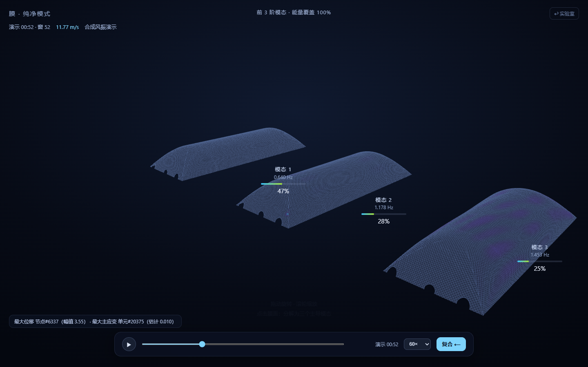

# MassLens 质量透镜 · WindLens 风透镜

观察一座 317 m 长的索网加劲气承式膜结构如何振动。打开 **纯净模式**，点击膜面，叠加振动会展开成三个独立播放的主导模态。屏幕显示各模态的频率和参与量占比，点 **复合** 可返回整体振动。



## 运行

Windows 用户可下载 [免安装版](https://github.com/XiangyuGong666/MassLens/releases)。解压整个 ZIP 后打开 `MassLens.exe`，再选顶部的 **纯净模式**。桌面窗口使用 Microsoft Edge WebView2。

源码需要 Python 3.10 或以上版本。以下命令在仓库根目录运行，使用 Python 3.12 验证。

```sh
python -m pip install -r requirements.txt
python -m masslens_ui
```

浏览器打开 `http://127.0.0.1:8000`。进入 `/zen?win=52` 可从示例阵风片段开始；在 Windows 上可用 `python -m masslens_ui.desktop --page zen` 直接启动纯净模式。两种入口均在本机运行，演示所需的模型、数据和前端库随源码提供。

| 页面 | 功能 |
| --- | --- |
| `/` 质量透镜 | 拖动附加质量滑块，查看各阶频率、MAC 匹配度和三维振型。 |
| `/wind` 风透镜 | 沿风振时间轴浏览风速、风向、响应强度、模态参与量和脉动风压场。 |
| `/zen` 纯净模式 | 播放叠加振动，点击膜面展开主导模态。展开后可点选单个模态观察。 |

## 示例与方法

- **有限元模型**来自气承式膜结构离线 MAPDL 参数化计算。HDF5 示例库含 11,009 个节点、15 个附加质量工况和每工况前 20 阶振型。质量透镜按 MAC 跟踪跨工况振型，在 `1/ω²` 空间插值频率。风透镜另使用同一网格的 60 阶有限元模态基。
- **风振演示**由三个有限元振型、合成阵风和 12 个虚拟测点生成，含 180 个一分钟窗及两个 10 Hz 时程片段。演示画面标有「合成风振演示」。模态重构为频域可视化。原现场监测记录、由实测派生的时间窗和现场照片由课题组保管。
- **模态组合库**使用有限元振型的等权同相包络。频域动画中的振幅经过可视化缩放。组合排名和动画均用于探索与演示。

运行 `python -m examples.generate_wind_demo` 可重生成合成风振数据。数据格式、输入路径和离线处理命令见 [数据与复现](docs/data.md)。

## 测试与打包

```sh
python -m unittest discover -s tests -t . -v
python -m masslens_interp.validate
```

两项现场识别表测试在表格缺失时自动跳过。Windows 上运行 `python -m pip install pyinstaller`，再运行 `python -m PyInstaller masslens.spec --noconfirm`，产物位于 `dist/MassLens`。

## License

[MIT](LICENSE) · [Citation](CITATION.cff) · [Third-party notices](masslens_ui/static/vendor/README.md)

MassLens visualizes how added mass changes the modal properties of a large air-supported membrane. WindLens replays wind-response data and opens an exploded view of the dominant modes in 3D. The public demo uses a finite-element model and synthetic wind and sensor signals.
